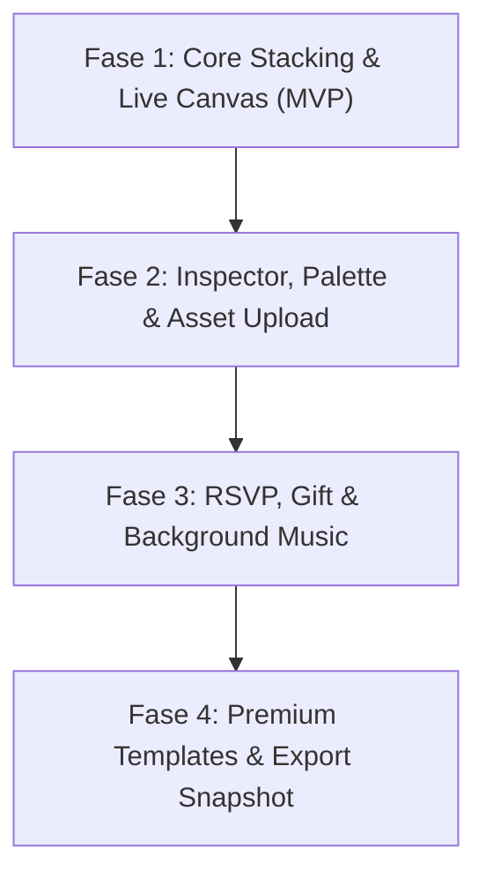

# Analisis Arsitektur & Spesifikasi Teknis Fitur Editor Tema/Undangan

> **Status**: VICTORY CONFIRMED (Verified Architectural Specification)  
> **Platform**: `invitation-wedding` (Next.js 15 App Router Frontend + Bun/ElysiaJS Hexagonal Backend)  
> **Tanggal**: 28 Oktober 2026  

---

## 1. Executive Summary & Latar Belakang

Fitur **Editor Tema dan Undangan Pernikahan Digital** merupakan inti fungsionalitas (*core value proposition*) dari platform `invitation-wedding`. Fitur ini memungkinkan calon pengantin menyusun dan menyesuaikan tampilan serta konten undangan pernikahan mereka secara visual, cepat, dan intuitif.

Untuk menghasilkan pengalaman penyuntingan yang superior ("baik dan keren") tanpa mengorbankan performa, stabilitas, dan keterbacaan kode, sistem ini dirancang dengan prinsip:
1. **Vertical Section Stacking**: Penyusunan berbasis blok vertikal yang menjamin 100% responsivitas di semua layar perangkat mobile tanpa risiko layout rusak (*anti-absolute dragging*).
2. **Dual-Domain Style Isolation**: Pemisahan tegas antara visual platform/dashboard UI dengan gaya visual undangan tamu melalui injeksi CSS Variables dinamis bertaraf scoped (`--inv-*`).
3. **Modular Section Registry**: Kemudahan memperluas varian desain kartu/bagian undangan melalui pola *Registry Pattern* bertipe ketat.
4. **Hexagonal Clean Architecture**: Backend berbasis port dan adapter dengan *single service call* controller dan pemisahan logika bisnis yang teruji.

---

## 2. Analisis UX/UI & Interaksi Editor

### A. Tiga Pilar Tata Letak Editor (Three-Pane Layout)
Editor dirancang dengan struktur 3 kolom utama yang ergonomis:
```text
┌─────────────────┬────────────────────────────────────────┬─────────────────┐
│  Left Navigator │             Center Canvas              │  Right Inspector│
│  (Section Tree) │        (Responsive Frame Mockup)       │ (Active Config) │
│                 │                                        │                 │
│ • Reorder list  │  ┌──────────────────────────────────┐  │ • Variant picker│
│ • Visibility eye│  │  📱 Mobile Frame (390 x 844)     │  │ • Color palette │
│ • Add section   │  │  [Ring Highlight Selected Block] │  │ • Content inputs│
│ • Preset theme  │  └──────────────────────────────────┘  │ • Typography    │
└─────────────────┴────────────────────────────────────────┴─────────────────┘
```

### B. Vertical Section Stacking (Anti-Absolute Dragging)
- **Problem Statement**: Pengeditan berbasis koordinat bebas piksel (*absolute positioning/free drag-and-drop*) seringkali tampak menarik di layar desktop pembuat, namun hampir selalu berujung pada kekacauan visual (*broken layout*, tumpang tindih teks, terpotong) ketika dibuka oleh tamu undangan di berbagai ukuran layar smartphone (iPhone, Android berbagai rasio).
- **Solusi Arsitektural**: Editor mengadopsi **Vertical Section Stacking** yang diatur menggunakan `@dnd-kit/core` dan `@dnd-kit/sortable`.
- **Fitur Interaksi**:
  - Drag handle vertikal untuk menukar urutan bagian (misal: memindahkan *Love Story* ke atas *Acara*).
  - Indikator drop-line yang mulus dengan transisi animasi CSS.
  - Tombol duplikasi dan hapus section dengan konfirmasi modal aman.

### C. Canvas Viewport Mockup & Section Selection
- **Chassis Mockup**: Kanvas tengah membungkus preview undangan dalam frame mockup perangkat yang dapat diganti ukurannya (`Mobile 390px`, `Tablet 768px`, `Desktop 100%`).
- **Active Section Highlighting**: Section yang sedang aktif disunting pada kanvas diberikan indikator visual berupa highlight ring seleksi (`ring-2 ring-primary`) dengan badge label di pojok kanan atas.
- **Direct Canvas Quick-Edit**: Klik pada salah satu blok di kanvas otomatis mengarahkan fokus inspector panel kanan ke konfigurasi section tersebut.

### D. Panel Inspektor Kanan (Contextual Inspector)
- Mengikuti seleksi aktif pengguna:
  - **Tata Letak / Varian**: Pilihan varian layout (misal: *Split Photo Grid*, *Arch Aesthetic*, *Minimalist Serif*).
  - **Formulir Data Terstruktur**: Field teks untuk Nama Lengkap, Nama Panggilan, Nama Orang Tua, Tanggal/Waktu Acara, URL Google Maps, nomor rekening, dsb.
  - **Upload Gambar Teroptimasi**: Kompresi otomatis gambar ke format `.webp` di sisi client (maksimum 1920px, 400KB) sebelum dikirim via URL presigned Cloudflare R2.

---

## 3. Arsitektur Teknis & State Management

### A. Modular Section Registry Pattern
Setiap jenis section undangan didefinisikan secara modular dan didaftarkan melalui registry terpusat:
```typescript
// src/modules/invitation-sections/registry.ts
export type SectionType = 
  | 'hero' 
  | 'couple' 
  | 'event' 
  | 'love_story' 
  | 'gallery' 
  | 'rsvp' 
  | 'wishes' 
  | 'gift';

export interface SectionRenderProps<TData = unknown> {
  id: string;
  data: TData;
  isActive?: boolean;
  onSelect?: () => void;
}

export const SECTION_REGISTRY: Record<
  SectionType,
  Record<string, React.ComponentType<SectionRenderProps<any>>>
> = {
  hero: {
    classic_centered: HeroClassicSection,
    romantic_floral: HeroRomanticSection,
    modern_editorial: HeroEditorialSection,
  },
  couple: {
    grid_two: CoupleGridSection,
    portrait_arch: CoupleArchSection,
  },
  event: {
    timeline_card: EventTimelineSection,
    split_details: EventSplitSection,
  },
  // section lainnya...
};
```

### B. Dual-Domain Style Isolation (Dynamic Scoped CSS Variables)
Platform memisahkan secara mutlak domain visual antarmuka pengelola (Dashboard/Editor Chassis) dengan tema undangan pernikahan:
- **Platform Domain**: Menggunakan token Tailwind CSS platform (`bg-background` `#FAF8F5`, `primary` `#B86B70`, `text-primary` `#3A302C`).
- **Invitation Domain**: Menggunakan variabel CSS yang diinjeksikan dinamis pada container kanvas via `src/lib/style-helpers.ts`:
  ```css
  .invitation-canvas-root {
    --inv-primary: #8C6A58;
    --inv-secondary: #E3D5CA;
    --inv-background: #FAF6F0;
    --inv-surface: #FFFFFF;
    --inv-text-primary: #3B302A;
    --inv-text-muted: #7D6E66;
    --inv-font-heading: 'Playfair Display', serif;
    --inv-font-body: 'Plus Jakarta Sans', sans-serif;
  }
  ```
- **Two-Font Typography Rule**:
  - `font-heading` (`Playfair Display`) dikhususkan secara ketat untuk judul utama (`h1`, `h2`).
  - `font-sans` (`Plus Jakarta Sans`) wajib digunakan untuk seluruh sub-judul (`h3–h6`), body text, kontrol tombol, input, dan kartu.

### C. State Synchronization & Debounced Auto-Save
- **Zustand Store (`useEditorStore`)**:
  - Mengelola `invitation` draft, riwayat undo/redo, status `isDirty`, dan `isSaving`.
  - Mutasi data section berlangsung instan di memori lokal (optimistic UI update pada kanvas).
- **Debounced Persistence**:
  - Perubahan di-debounce selama 1000ms sebelum dikirimkan ke endpoint `PUT /api/invitations/:id/draft`.
  - Menampilkan status visual di topbar: *"Menyimpan..."*, *"Draft tersimpan"*, atau *"Gagal menyimpan"*.

---

## 4. Skema Data & Kontrak API

### A. Skema Database Drizzle (`src/db/schema/invitations.schema.ts`)
```typescript
import { pgTable, uuid, varchar, jsonb, boolean, timestamp } from 'drizzle-orm/pg-core';
import { usersTable } from './users.schema';

export const invitationsTable = pgTable('invitations', {
  id: uuid('id').defaultRandom().primaryKey(),
  userId: uuid('user_id').references(() => usersTable.id).notNull(),
  slug: varchar('slug', { length: 120 }).notNull().unique(),
  title: varchar('title', { length: 255 }).notNull(),
  themeId: varchar('theme_id', { length: 64 }).notNull(),
  themeConfig: jsonb('theme_config').$type<ThemeConfigDTO>().notNull(),
  sections: jsonb('sections').$type<SectionNodeDTO[]>().notNull(),
  isPublished: boolean('is_published').default(false).notNull(),
  publishedAt: timestamp('published_at', { withTimezone: true }),
  createdAt: timestamp('created_at', { withTimezone: true }).defaultNow().notNull(),
  updatedAt: timestamp('updated_at', { withTimezone: true }).defaultNow().notNull(),
});
```

### B. DTO Data Section & Theme Config
```typescript
export interface ThemeConfigDTO {
  presetId: string;
  palette: {
    primary: string;
    secondary: string;
    background: string;
    surface: string;
    textPrimary: string;
    textMuted: string;
  };
  typography: {
    headingFont: 'Playfair Display' | 'Cormorant Garamond' | 'Cinzel';
    bodyFont: 'Plus Jakarta Sans' | 'Inter';
  };
}

export interface SectionNodeDTO {
  id: string;
  type: SectionType;
  variant: string;
  order: number;
  isVisible: boolean;
  content: Record<string, unknown>;
}
```

### C. Endpoint API (Hexagonal Architecture)
Sesuai aturan arsitektur bersih ElysiaJS:
- **`PUT /api/invitations/:id/draft`**:
  - Controller: `InvitationController.saveDraft` (memanggil tepat 1 method `invitationService.saveDraft`).
  - Response: Envelope terpadu dengan Custom Code `1002` (DRAFT_SAVED).
- **`POST /api/invitations/:id/publish`**:
  - Memverifikasi status kuota dan langganan aktif pengguna sebelum mengubah `isPublished = true`.
  - Response: Envelope terpadu dengan Custom Code `1003` (INVITATION_PUBLISHED).
- **`POST /api/invitations/:id/apply-template`**:
  - Mengganti seluruh susunan section dan palet warna dengan template bawaan pilihan.
  - Response: Custom Code `1000` (SUCCESS_OK).

---

## 5. Roadmap Implementasi Bertahap (Phased Rollout)



| Fase | Target Milestone | Rincian Deliverables | Estimasi Prioritas |
| :--- | :--- | :--- | :--- |
| **Fase 1 (MVP)** | Fondasi Editor & Sinkronisasi Draft | • Implementasi vertical reordering dengan `@dnd-kit`.<br>• Canvas viewport mockup responsif (Mobile frame 390px).<br>• Dual-domain CSS variable injector.<br>• Debounced auto-save draft API (`PUT /api/invitations/:id/draft`). | **P0 (Kritis)** |
| **Fase 2** | Inspector & Desain Kustom | • Panel inspector kanan dengan selector varian layout.<br>• Pemilihan palet warna & tipografi Two-Font.<br>• Kompresi WebP client-side & presigned upload Cloudflare R2. | **P1 (Tinggi)** |
| **Fase 3** | Fitur Interaktif & Tamu | • Form RSVP dinamis terhubung database.<br>• Integrasi nomor rekening / QRIS amplop digital.<br>• Floating audio player untuk lagu pengiring (background music). | **P1 (Tinggi)** |
| **Fase 4** | Skalabilitas & Marketplace Tema | • Koleksi tema tematik siap pakai (Adat Jawa, Sunda, Modern Luxury, Rustic).<br>• Fitur moderasi ucapan tamu secara realtime.<br>• Duplikasi undangan & pembuatan tautan nama tamu personal (`/[slug]?to=Nama+Tamu`). | **P2 (Lanjutan)** |

---

## 6. Kesimpulan & Rekomendasi Arsitektural

Editor tema undangan yang "baik dan keren" tidak dibangun dengan fleksibilitas tanpa batas yang memicu kerapuhan (*unconstrained absolute layout*), melainkan dengan **pembatasan berdesain cermat (*opinionated guardrails*)**:
1. Menjaga struktur tetap vertikal memastikan undangan yang dibuat mempelai pasti tampil memukau di seluruh smartphone tamu.
2. Isolasi token styling menjamin antarmuka pengelola tetap bersih, profesional, dan tidak bertabrakan dengan nuansa warna pernikahan yang dipilih pengguna.
3. Kepatuhan terhadap *Hexagonal Architecture* dan larangan tipe `any` menjaga basis kode tetap teruji, modular, dan mudah dipelihara dalam jangka panjang.
